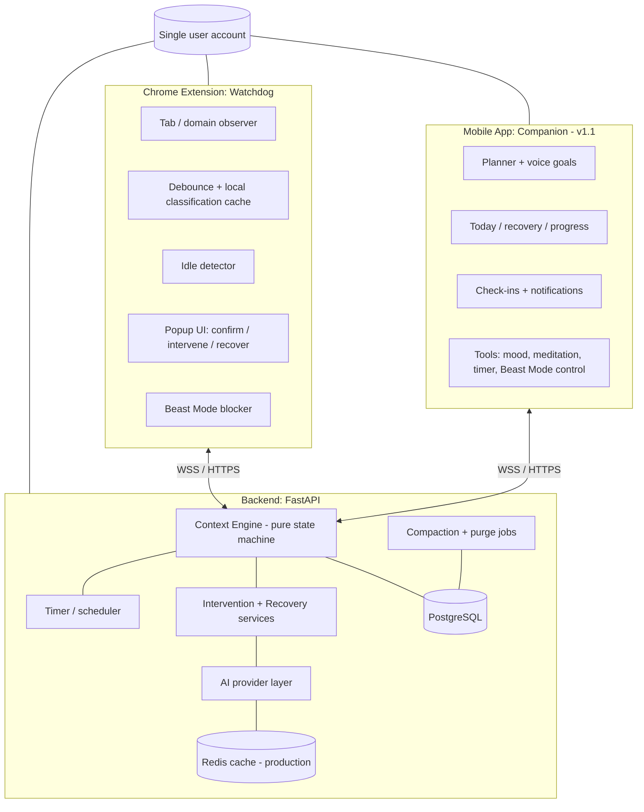
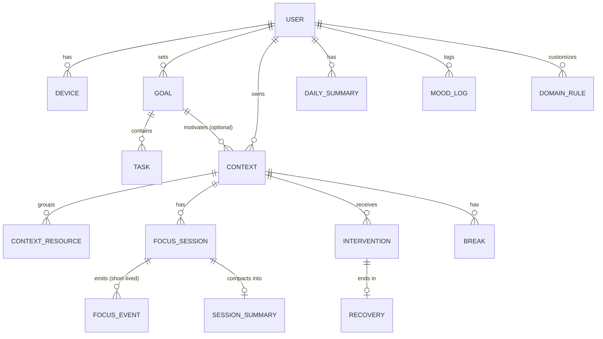
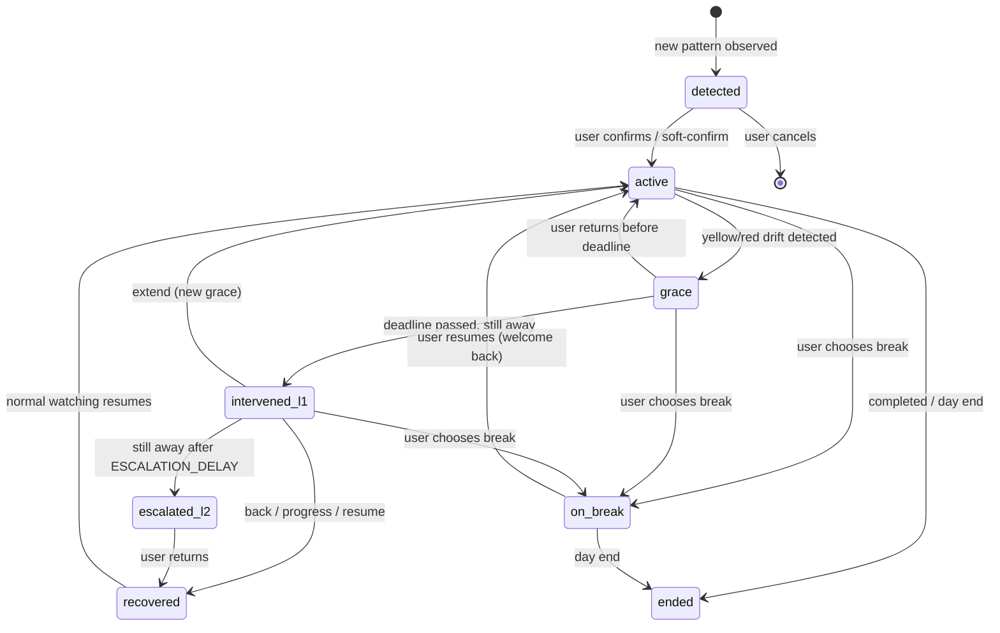

# FocusGuard — Product & Engineering Spec

**AI-Powered Productivity System** · by **Team MindMess**

> This is the product spec (intent). The runbook is the root `README.md`; current build status is `docs/STATUS_AUDIT.md`; decisions are logged in `docs/DECISIONS.md`. Formerly `README 1.md`; decisions D-1..D-4 applied 2026-10-10.

> *We don't stop distraction. We preserve continuity.*

FocusGuard is a cross-device AI focus companion. It learns what you intended to work on, understands your active context, quietly watches for *meaningful* drift, **waits before intervening**, communicates in a gentle, human way, and preserves enough context to put you back exactly where you left off.

---

## 0. How to use this document (read this first)

This document is the **engineering handoff spec**. It is written so that a developer, or another LLM coding agent, can continue the project without the original authors in the room.

### 0.1 Source-of-truth hierarchy

1. **The code in the repository is reality.** If this document disagrees with the code about what *exists*, trust the code.
2. **This document is intent.** If the code disagrees with this document about what *should* happen, do **not** silently change either. Record the discrepancy in `docs/DECISIONS.md` and flag it to a human.
3. Pitch decks, chats, and older notes are background only.

### 0.2 Status markers used in this document

| Marker | Meaning |
|---|---|
| 🟢 **EXISTS** | Reported as already implemented in the original codebase. **Verify in code before relying on it.** |
| 🟡 **PARTIAL / UNKNOWN** | Some foundation exists or status is unclear. Audit first. |
| ⚪ **SPEC** | Designed but not built. Everything marked SPEC is a proposal you may refine, as long as you honor the principles in §3. |

### 0.3 Normative language

**MUST / MUST NOT / SHOULD / MAY** are used in the RFC 2119 sense. Principles in §3 and privacy rules in §15 are **MUST**-level and non-negotiable without human sign-off.

### 0.4 Rules of engagement for a coding agent

1. **Audit before building.** `docs/STATUS_AUDIT.md` (2026-10-10) maps `src/`, `backend/`, `extension/` to §5 to §14. Read it first and keep it current.
2. **Extend, don't replace.** The backend, extension, and app are a working demo. Evolve them. Existing screens are *not sacred*; existing working components and logic should be reused.
3. **Keep the engine pure.** The Context Engine (§8) MUST be a deterministic function with injected time. No `datetime.now()` inside it. This is what makes it testable.
4. **AI is at the edges, never in the core loop.** Detection, timers, and state transitions are rule-based (§3, P6).
5. **Small, reviewable changes.** One concern per PR. Add or extend tests with every behavior change.
6. **Never log or transmit anything forbidden by §15**, even in debug code.
7. **Ask a human when** a decision touches privacy, pricing/gating, tone/copy that might shame a user, or anything listed in §23 (Open Questions).
8. **Record decisions** in `docs/DECISIONS.md` (date · decision · rationale · alternatives).

### 0.5 Copy-paste kickoff prompt for an LLM agent

```text
You are continuing development of FocusGuard. Read docs/SPEC.md, docs/STATUS_AUDIT.md and docs/DECISIONS.md fully.
Step 1: Re-verify docs/STATUS_AUDIT.md against the code and update anything stale.
Step 2: Work from the phase plan in docs/STATUS_AUDIT.md §8 (which supersedes SPEC §21 ordering).
Step 3: Implement only the current phase. Do not start later phases without approval.
Constraints: obey the principles in section 3 and privacy rules in section 15; keep the Context Engine pure
and unit-tested; do not add ads, tracking SDKs, or individual employee monitoring; prefer extending existing
modules over rewriting them. Surface any conflict between code and docs/SPEC.md instead of resolving it silently.
```

---

## 1. Product in one page

**One-sentence definition (the north star):**

> FocusGuard is a cross-device AI companion that understands what you intend to work on, automatically understands your active context, quietly watches for meaningful distraction, waits before intervening, communicates through gentle and human interactions, and preserves enough context to help you return exactly where you left off.

**Core promise:** *"You don't have to remember where you left off. FocusGuard does."*

**The problem:** people lose productive time because they lose **context**. After any interruption they must rebuild what they were doing, why, what was finished, what was next, and which resources mattered. This hits people with ADHD hardest.

**Scope (D-2):** **v1 = Chrome extension + small web dashboard (Expo web build) + backend.** The mobile companion is **v1.1**. Sections and rows about mobile are kept below and marked **(v1.1)**.

**Surfaces, one account:**

| Surface | Role | Knows about |
|---|---|---|
| **Chrome extension (desktop)** | **Watchdog**: observes the actual working environment | Active tab, domain, sanitized title, tab switches, idle/active state |
| **Web dashboard** (Expo web build of `src/`) | Today's goal, current context, narrative, settings, export/delete | Goals, current context state, summaries |
| **Mobile app (v1.1)** | **Companion**: planning, progress, check-ins, tools, recovery | Goals, current context state, summaries, notifications |
| **Backend** | Accounts, storage, sync; see §5 and O-1 for where the engine runs | Everything synced via the user's account |

The mobile app does **not** try to observe other Android apps. That is a deliberate scope boundary.

**Positioning vs. alternatives:**

| | Screen-time tools / blockers | FocusGuard |
|---|---|---|
| Unit | App/screen time | **Context** (task/goal) |
| On a tab switch | Count or block | Reason about it, wait, then maybe nudge |
| Tone | Sterile/punitive | Companion: gentle first, playful later, never shaming |
| Resume support | None | **Context recovery** is the core feature |
| Devices | Usually one | Desktop + mobile, one account |

---

## 2. Implementation status

Status lives in **`docs/STATUS_AUDIT.md`** (source of truth; update it in the same PR as the change). This spec does not track status.

---

## 3. Product principles (MUST-level)

| # | Principle | Practical consequence |
|---|---|---|
| **P1** | **Do not interrupt simply because something changed.** A context switch is not a distraction. | Every nudge must pass the full reasoning chain in §9.1. |
| **P2** | **User intent beats inference.** AI proposes a context; the user confirms. | Unconfirmed contexts are marked lower-confidence; never silently overwrite a user's title or mode. |
| **P3** | **Grace before intervention. Always.** | No intervention may fire before the grace deadline; enforced by test (§19). |
| **P4** | **Never punish, never shame.** | No red "FAILED" screens, no "minutes wasted" counters, no guilt on missed goals or broken streaks. |
| **P5** | **Escalate in tone, not in force.** | Level 2 is playful, not blocking. Only Beast Mode (user-initiated) may block. |
| **P6** | **Deterministic core, AI at the edges.** | Classification of known domains, timers, flags, and the state machine use no AI. |
| **P7** | **Privacy by minimization.** | See §15. Collect the minimum, keep it briefly, send AI the least. |
| **P8** | **Graceful degradation.** | AI down → templates. Backend down → local fallback. Offline → buffer and reconcile. |
| **P9** | **One account, one truth.** | Server is authoritative for context state; devices send intents, not states (§17). |
| **P10** | **Context is the unit.** | Features attach to contexts, not to raw timers or app usage. |

### 3.1 Explicit non-goals / anti-patterns

FocusGuard MUST NOT become:

- **A surveillance product.** No individual employee monitoring. Team features are aggregate and opt-in only.
- **A punishment system.** Missing goals creates no guilt.
- **A generic blocker.** Not every distraction is blocked. Beast Mode is the only strict mode, and the user chooses it.
- **A Pomodoro clone.** The timer is a supporting tool.
- **A screen-time dashboard.** Numbers appear only where they help self-understanding.
- **A generic AI chatbot.** AI is embedded in the workflow, not a chat window.
- **A medical app.** No clinical claims. Wellbeing language is supportive, not diagnostic.
- **A notification machine.** Every interruption must be intentional and contextual.
- **Ad-supported.** No ads, ever. Ads are themselves a distraction.
- **A user of real people's names/likenesses** for mascots or personalities (publicity-rights risk). Use original or folklore-inspired characters.

---

## 4. Personas

| Persona | Pain | What they need most |
|---|---|---|
| Students / self-learners | Lose the thread between lecture, notes, and "one quick video" | Gentle structure, recovery after breaks |
| Developers & founders | Tab spirals through docs, issues, Stack Overflow | Don't flag legitimate research; resume where they were |
| Remote / freelance professionals | No external structure; context scattered across tools | Daily plan + continuity |
| People who struggle with attention (incl. ADHD) | Task-switching cost, shame from blockers | Non-punitive tone, low-friction resume, predictable behavior |

---

## 5. System architecture



**Key architectural rules**

- The extension and the mobile app **never talk directly**. They sync via the backend.
- The **Context Engine** is the single authority for context state and timers (see §8, and open decision O-1: STATUS_AUDIT Q-1 recommends running it **in the extension** for v1).
- The engine is **pure**: `step(state, input, now, config) → (new_state, effects)`.
- Clients send **commands/intents** (e.g. "confirm context", "take break"). The server returns authoritative snapshots with a monotonically increasing `version`.

---

## 6. Domain model

### 6.1 Concepts (keep these distinct even if implementation details evolve)

| Concept | Definition | Example |
|---|---|---|
| **Goal** | What the user intends to accomplish today | "Finish client video" |
| **Task** | A concrete unit of work | "Add final color correction" |
| **Context** | The larger environment/activity around the work | "Client Video Editing" |
| **Context Group** | Related activity belonging to one context | Premiere + YouTube tutorial + Drive assets |
| **Session** | A period of active work in a context | 10:00 to 11:15 Video Editing |
| **Event** | A temporary activity signal | Switched from Premiere to YouTube |
| **Intervention** | A FocusGuard attempt to bring attention back | "Still taking a detour?" |
| **Recovery** | The user's return to an interrupted context | "Welcome back, you were on color correction" |

### 6.2 Proposed schema (⚪ SPEC; adapt names to the existing models)



| Table | Key fields (type) | Notes |
|---|---|---|
| `users` | id, email, tz, plan (`free`/`premium`), created_at | |
| `devices` | id, user_id, kind (`extension`/`web`/`mobile`), push_token?, last_seen_at | `mobile` is v1.1 |
| `goals` | id, user_id, text, category (`work`/`learning`/`personal`), date, status | From planner |
| `tasks` | id, goal_id?, context_id?, text, status, completed_at | |
| `contexts` | id, user_id, title, mode, state (§8), confidence (`inferred`/`confirmed`), version (int), last_active_at, ended_at | `version` increments on every state change |
| `context_resources` | id, context_id, domain, label (sanitized title), first_seen_at, last_seen_at, visit_count | Grouping; **no full URLs** |
| `focus_sessions` | id, context_id, started_at, ended_at, focus_seconds | |
| `focus_events` | id, session_id, ts, kind, domain, tier, dwell_ms, client_event_id | **Raw. TTL ≤ 7 days.** |
| `interventions` | id, context_id, level (1/2), shown_at, drift_seconds, tier_at_trigger, response (`back`/`progress`/`extend`/`break`/`dismiss`/`none`), responded_at, copy_id, is_effective (bool?, user stayed in context ≥ 3 min after) | `is_effective` feeds nudge-usefulness metrics (§20) |
| `recoveries` | id, context_id, intervention_id?, trigger (`intervention`/`self_returned`/`break_ended`/`checkin`), away_seconds, returned_at, stuck (bool, still in context after 10 min?) | Record **self-returns** too (drift ended before grace, no nudge): the strongest positive signal, and the input to adaptive grace (§9.4) |
| `breaks` | id, context_id, started_at, ended_at, snapshot_json | Snapshot = what recovery needs |
| `session_summaries` | id, session_id, focus_seconds, interventions, recoveries, longest_detour_s, top_resources_json | Compact; survives raw purge |
| `daily_summaries` | id, user_id, date, stats_json, narrative_text, generated_by (`template`/`ai`) | |
| `domain_classifications` | domain, tier (`green`/`yellow`/`red`/`unknown`), source (`seed`/`ai`/`user`), confidence, updated_at | Global cache |
| `domain_rules` | id, user_id, domain, tier_override, context_id? | User feedback ("this is related") |
| `mood_logs` | id, user_id, ts, value (1-5) | |
| `achievements` | id, user_id, key, unlocked_at | |
| `preferences` | user_id, grace_seconds, inactivity_seconds, tone_pack, quiet_hours, notifications_json | |

### 6.3 Enums

```text
ContextMode:    work | learning | personal
ContextState:   detected | active | grace | intervened_l1 | escalated_l2 | recovered | on_break | ended
DomainTier:     green | yellow | red | unknown | sensitive   (sensitive = never logged)
Response:       back | progress | extend | break | dismiss | none
```

---

## 7. Context detection, confirmation, and grouping

### 7.1 Detection (⚪ SPEC / 🟡 PARTIAL)

1. The extension observes a sustained landing (≥ `DWELL_MIN_S`) on a domain/title pattern not belonging to any active context.
2. Backend infers a **proposed context** (title + mode) from `{domain, sanitized title, today's goals}` using a cheap model (§12.2), or rules for known domains.
3. Server emits `context.proposed` to the extension popup.

### 7.2 Confirmation UX

> **New context detected**: *Client Video Editing* · Mode: Work · **[Cancel] [Okay]**

- Title MUST be editable; mode MUST be one of Work / Learning / Personal.
- **Soft-confirm:** if no response within `SOFT_CONFIRM_TIMEOUT_S` (90s), proceed as the inferred context with `confidence = inferred`. Never re-prompt repeatedly.
- **Cancel** suppresses re-proposal of that exact domain+title pattern for the session.
- Ambiguity is expected ("React Documentation" could be Learning, Work, or unrelated): the system *proposes*, the user *decides* (P2).

### 7.3 Grouping rules

- Activity joins the active context if it is (a) Green tier, (b) the same domain as an existing resource, (c) classified related by the cheap model given the context title (cached per context), or (d) user-marked related (`domain_rules`).
- Never create five contexts for Figma → Google Fonts → Pinterest → Photoshop → Figma. Resolve to one **Landing Page Design** context.
- **Back-to-back legitimate contexts:** sustained, coherent activity unrelated to the old context proposes a **new** context; the old one ends as `completed`, not `interrupted`.

---

## 8. Context lifecycle: the state machine



### 8.1 Transition table (authoritative)

| From | Trigger | Guard | To | Effects |
|---|---|---|---|---|
| detected | `confirm` or soft-confirm timeout | none | active | start session; persist title/mode; `context.state` |
| detected | `cancel` | none | (removed) | suppress pattern |
| active | `landing(tier ∈ {yellow, red})` | not in break; not Beast Mode | grace | compute grace (§9.4); schedule timer; record `drift_started_at` |
| active | `landing(tier=green)` | none | active | add resource silently |
| grace | `landing(related)` | none | active | cancel timer |
| grace | `timer_fired` | `now ≥ deadline`, hourly cap ok, quiet hours ok | intervened_l1 | emit L1; schedule escalation timer |
| grace | `timer_fired` | cap or quiet-hours blocks | active\* | log `suppressed`, **do not nudge** |
| intervened_l1 | `respond(back)` | none | recovered | focus tab; log recovery |
| intervened_l1 | `respond(progress)` | none | intervened_l1 | show progress card; keep waiting |
| intervened_l1 | `respond(extend, n)` | n ∈ allowed | active (new grace) | grace = n; does **not** count as ignoring |
| intervened_l1 | `respond(break)` | none | on_break | snapshot for recovery |
| intervened_l1 | `escalation_timer` | still away; L2 allowed | escalated_l2 | emit L2 (playful, non-blocking) |
| escalated_l2 | `landing(related)` | none | recovered | log recovery |
| any active-ish | `break_start` | none | on_break | snapshot; cancel timers |
| on_break | `break_end`/`resume` | none | active | emit `recovery.ready` (welcome back) |
| active/on_break | `end` / day rollover | none | ended | close session; schedule compaction |

\* Suppressed nudges return to `active` but record the suppressed drift for analytics; they do not count as user failures.

### 8.2 Engine contract

```python
# Pure. No I/O, no wall-clock reads, no AI calls.
def step(state: ContextState, inp: EngineInput, now: datetime, cfg: EngineConfig) -> tuple[ContextState, list[Effect]]: ...

EngineInput = LandingEvent | UserCommand | TimerFired | IdleChanged | Heartbeat
Effect = ScheduleTimer | CancelTimer | EmitIntervention(level) | EmitCheckin | ProposeContext
       | EmitRecovery | PersistResource | PersistEvent | Log(level, msg)
```

The service layer executes effects (schedule jobs, push over WebSocket, call AI for copy). The engine never does.

---

## 9. Drift detection engine

### 9.1 The reasoning chain (every nudge MUST pass all of it)

```text
What was the user doing?          → active context
What was their intended goal?     → goal/task linkage
What changed?                     → landing event (after debounce)
Is the new activity related?      → tier + context relatedness (§9.2, §7.3)
How long has the change lasted?   → dwell + rolling window (§9.3)
Did the user intentionally pause? → break state / extend / Beast Mode
Should FocusGuard intervene?      → grace elapsed + caps + quiet hours (§10.2)
```

### 9.2 Destination tiers (deterministic lookup)

| Tier | Examples | Behavior |
|---|---|---|
| 🟢 **Green** | Docs sites, GitHub, Jira, Stack Overflow | Log silently into the context. **No grace period.** |
| 🟡 **Yellow** | YouTube, Wikipedia | Start grace; run **velocity check** (§9.3). Staying on one page → treat as productive. High velocity → treat as Red, shorten grace. |
| 🔴 **Red** | Twitter/X, Reddit, Instagram, TikTok | Grace starts immediately; no benefit of the doubt. |
| ⚫ **Sensitive** | Banking, health, password managers, private messaging, government/tax | **Never logged, never transmitted, never shown, never sent to AI** (§15). Excluded in the extension. |
| ❔ **Unknown** | Unseen domain | Ask the cheap model once (§12.2) with the *domain + sanitized title + context title*; cache the answer; default to **trust** until cached. |

Resolution order: `user rule` → `sensitive` → `seed list` → `cache` → `AI (once)` → `unknown→trust`.

### 9.3 Debounce, rolling window, velocity

```text
DWELL_MIN_S            = 4     # a switch only "lands" after this long on a tab
ROLLING_WINDOW_S       = 60
VELOCITY_PAGES_HIGH    = 5     # distinct pages/videos within window → high velocity
```

- **Debounce:** alt-tabbing through 6 tabs in 2 seconds produces **zero** landings until the user settles.
- **Velocity:** compute over the rolling window on Yellow (and optionally Green, §23 O-6) destinations.
  - Low velocity (one video / page, long dwell) → treat as productive; no escalation.
  - High velocity (≥ `VELOCITY_PAGES_HIGH` distinct pages, short dwell) → **downgrade Yellow→Red behavior** and apply the velocity factor to grace.
- **Grace timer anchoring:** the deadline is computed from the **original `drift_started_at`**. Switching tabs inside grace MUST NOT reset it (prevents accidentally gaming/resetting by fidgeting).
- Rapid scattered switching is a **signal**, not noise. Do not suppress it; read it.

### 9.4 Grace period (including adaptive grace)

```text
GRACE_DEFAULT_S = 300   (user-configurable: 120 / 300 / 600 / custom)
GRACE_MIN_S     = 60
GRACE_MAX_S     = 900
```

**Cold start:** for the first `COLD_START_DAYS` (3) of data, use the default uniformly. Only personalize after a baseline exists.

**Adaptive formula (⚪ SPEC, proposed defaults, tunable, put every constant in config):**

```python
grace = clamp(
    base * momentum_factor * risk_factor * baseline_factor * velocity_factor,
    GRACE_MIN_S, GRACE_MAX_S)

momentum_factor:  in_context_min < 20 → 1.0 | 20-45 → 0.7 | > 45 → 0.4   # never > 1.0 (D-3)
risk_factor:      yellow → 1.2 | red → 1.0
baseline_factor:  if days_of_data ≥ 3 and median_self_return_s known:
                      clamp(median_self_return_s / base, 0.7, 1.3) else 1.0
velocity_factor:  high velocity → 0.5 else 1.0
HIGH_MOMENTUM_FLOOR_S = 120   # high momentum: grace = max(result, 120s), i.e. ~2 min (D-3)
```

**Momentum rule (D-3, MUST).** A long unbroken stretch inside the active context makes grace **shorter** if the user then drifts: catch the drift before momentum is lost. Deep focus never earns *extra* grace (`momentum_factor ≤ 1.0` always).

- **Momentum is time inside the active context** (Green/related landings, excluding breaks and grace windows), **not** "no tab switches". Two hours on one YouTube tab with zero switches is not deep focus; if YouTube is not part of the context, that time counts as drift, not momentum.
- With high momentum (> 45 min in context), the result is floored at `HIGH_MOMENTUM_FLOOR_S` (120s). This replaces the earlier `> 45 → ×1.25` rule, which was wrong.

Illustrative outcomes (base = 300s):

| Situation | Momentum | Tier | Velocity | Result |
|---|---|---|---|---|
| 1 hr deep editing → one Reddit visit | ×0.4 | red ×1.0 | low | 120s (floor) |
| 30 min in context → Reddit | ×0.7 | red ×1.0 | low | ~210s |
| 5 min into session → Instagram | ×1.0 | red ×1.0 | low | ~300s |
| 10 min in → YouTube, several videos fast | ×1.0 | yellow ×1.2 | high ×0.5 | ~180s |
| 2 h on one unrelated YouTube tab (zero switches) → Reddit | ×1.0 (no in-context time) | red ×1.0 | low | ~300s |
| User usually returns on their own in 2 min | ×1.0 | red | low | baseline ×0.7 → ~210s |

#### 9.4.1 Snooze-adaptive grace (v1.1, ⚪ SPEC; D-4)

v1 ships **fixed grace + a manual setting**. Build this only once outcome metrics (§20) exist to tune it. Silently learning from snoozes learns from avoidance and ratchets toward never nudging, so:

1. **Ask, don't adjust.** After ~3 snoozes (`extend`) on the same kind of detour, ask once: *"You usually want ~10 more minutes on YouTube. Make that your default?"* Yes/No. Never change grace silently.
2. **Only count snoozes that end in a self-return** (`recoveries.trigger = self_returned` before the extended deadline). Snooze → snooze → ignore never raises grace.
3. **Scope per destination/context**, **cap at 15 min**, and **decay** back toward the default when the user starts returning early on their own.

Learned values are shown in Settings and resettable (§10.4).

### 9.5 Inactivity (not the same as drift)

- Use `chrome.idle` with `INACTIVITY_THRESHOLD_S` (default 600).
- Inactivity does **not** enter the drift path and does **not** produce a desktop overlay.
- Instead emit a **silent/gentle mobile check-in (v1.1)**: *"Still working on React?"* → **Continue / Take a break / Remind me later**. In v1 (no mobile) there is no check-in; idle still never enters the drift path.
- Only one check-in per idle episode. If the user answers *Take a break*, go to `on_break`.

---

## 10. Intervention system

### 10.1 Levels

| Level | When | Form | Actions |
|---|---|---|---|
| **L1: Gentle** | Grace elapsed, user still away | Small popup/notification | **Back to work · See progress · Extend timer** |
| **L2: Playful** | Still away `ESCALATION_DELAY_S` (300) after L1 | Small animation / mascot / floating dialog / light overlay. **Never full-screen blocking.** | Same actions + dismiss |

- **Back to work:** focus the relevant context tab (resume target is device-local, §11.2).
- **See progress:** show what was done before the interruption plus the next step.
- **Extend timer:** choices e.g. 2 / 5 / 10 min. The user is explicitly saying "give me more time": **respect it** and do not count it as being ignored.

### 10.2 Anti-spam and cooldowns (MUST)

```text
INTERVENTION_MAX_PER_HOUR = 3
L1_MIN_GAP_S              = 600
```

- Honor quiet hours and OS focus modes where detectable.
- If a user dismisses/ignores ≥ 3 interventions in a day, **reduce frequency** for that day.
- No intervention during `on_break`, Beast Mode, or inside a grace window.
- If a cap suppresses a nudge, log `suppressed`; do **not** queue it for later.

### 10.3 Voice & personality

**Supportive friend + intelligent assistant + lightweight watchdog.** Not teacher, parent, or corporate manager.

Traits: warm · encouraging · playful · context-aware · slightly Gen-Z · emotionally intelligent · **never humiliating**. Avoid constant slang, forced memes, childishness, insults.

| Instead of | Prefer |
|---|---|
| "Distraction detected." | "Looks like we took a little detour." |
| "You have exceeded your break." | "Want a few more minutes, or are we heading back?" |
| "Return to task." | "Your project is waiting for you." |

**Example copy bank (seed templates; also the AI fallback, §12):**

```yaml
l1:
  - "Still taking a detour? You were working on {context}."
  - "Quick check-in: {context} is right where you left it."
  - "Want a few more minutes, or are we heading back to {context}?"
l2:
  - "Your {context} is crying in the corner 😭"
  - "Bro, {context} is still waiting for you."
  - "Plot twist: {context} didn't finish itself."
recovered:
  - "You're back. Let's finish it."
welcome_back:
  - "Welcome back. You were on {next_step}."
```

**Banned in generated copy:** "lazy", "failed", "wasted", "distracted again", "you should have", "disappointing", guilt-framing, comparisons to other users. Any AI output containing banned terms is rejected and replaced by a template (§12.4).

**Personality packs (cosmetic, potentially Premium):** Gentle (default) · Playful/Gen-Z · Strict Coach (Beast Mode) · Wise Elder · Hype Friend. Mascot characters should be **original or folklore-inspired** (e.g., Yeti, Garuda, Sherpa-archetype), never real people. Support `en` and `ne` copy sets (§22).

### 10.4 Learning from responses

Record `response` for every intervention. Over time (SPEC): adjust grace baseline (§9.4), prefer copy that gets `back`, reduce frequency on repeated dismissals. Learning MUST be explainable and reversible (a reset button in Settings).

---

## 11. Recovery and breaks (the centerpiece feature)

### 11.1 Breaks are first-class, not failures

*Take a break* snapshots the context. On return: **"Welcome back."** + where you were + **Resume**.

**Ready-to-resume note (SHOULD, v1).** When taking a break **or snoozing** (`extend`), offer one optional line: *"Leave yourself a note for next time?"* (free text or voice, one tap to skip; stored on the break/intervention). On return it is shown **first** on the recovery card and used as `user_note` / the "next" text in preference to any inferred summary. Rationale: a brief plan written at the moment of interruption is the best-evidenced resumption aid (Leroy & Glomb 2018), and user-encoded cues beat inferred ones; see `docs/research/2026-10-10-focus-recovery-research.md` §1.

### 11.2 Recovery payload

```json
{
  "context_id": "ctx_123",
  "context_title": "FocusGuard Landing Page",
  "away_seconds": 3420,
  "completed": ["Hero section"],
  "next": "Fix mobile spacing",
  "user_note": "check 375px breakpoint",
  "resources": [{"domain": "figma.com", "label": "Landing v3"}, {"domain": "pinterest.com", "label": "Design reference"}],
  "generated_by": "template"
}
```

- `completed` / `next` derive from **tasks** (done / next-open) plus the last N context-related sanitized page labels. The model may phrase them; it must not invent facts.
- **Resume target** (tab/window id, full URL) is stored **only on the device** in extension local storage. It is **never sent to the server**. "Back to work" resolves it locally.
- Example delivery: *"You were working on the FocusGuard landing page. You completed the hero section. You were about to fix mobile spacing. Related: Figma and the design reference. **Continue**."*

### 11.3 Recovery success metric

A recovery is `stuck = true` if the user is still in-context 10 minutes after returning. Track `recovery_time_s` = intervention shown → back in context.

---

## 12. AI layer

### 12.1 Where AI is used (and not)

| # | Task | Frequency | Model class | Fallback |
|---|---|---|---|---|
| 0 | Audio → text | 1×/morning | On-device first; Whisper API if low confidence/unsupported | Typed input |
| 1 | Text → structured goals | 1×/morning | Cheap/fast (e.g. GPT-4o-mini, Gemini Flash, DeepSeek) | Rule-based splitter + manual edit |
| 2 | Ambiguous domain/context classification | Only unseen domains; cached | Cheapest/fastest (or local Ollama) | Trust (treat as Green) |
| 3 | Intervention / recovery copy | On drift only | Stronger conversational (Claude / GPT-4o class) | Template bank (§10.3) |
| 4 | Daily narrative + Premium pattern insights | 1×/day | Stronger reasoning | Template narrative from stats |

**Not AI:** known-domain classification, debounce, velocity, grace timers, flag escalation, state transitions, caps/cooldowns.

### 12.2 Router requirements

- Per-task provider **priority chain** with automatic fallback on timeout/error/invalid output.
- **Mock provider** is always last. The product MUST fully function with zero AI keys.
- AI calls MUST be **async and off the critical path**: the Watchdog never waits on AI to classify a known domain or run a timer.
- **Cache** classifications (Redis in prod; in-process/DB in dev). Cache key: `domain` (+ `context_title` hash for relatedness).
- Per-user **rate limits** on AI-triggering actions; per-provider **spend tracking**.
- Secrets via environment/secret manager only. Never in the repo.

### 12.3 Payload schemas (what the AI is allowed to see)

AI calls are **stateless and request-scoped**. No history feed. No raw event dumps.

```json
// Task 2: domain classification
{"domain": "youtube.com", "title": "React Hooks Tutorial", "context_title": "Learning React", "mode": "learning"}
// → {"tier": "green|yellow|red", "related": true, "confidence": 0.0-1.0}
```

```json
// Task 3: intervention copy
{"level": 1, "context_title": "Client Video Editing", "drift_minutes": 22,
 "current_tier": "red", "prior_interventions_today": 1, "tone_pack": "playful", "lang": "en"}
// → {"message": "…max 140 chars…"}
```

```json
// Task 4: daily narrative (numbers are computed deterministically FIRST)
{"focus_minutes": 245, "interventions": 1, "recoveries": 1, "longest_detour_min": 6, "goals_done": 2, "goals_total": 3}
// → {"narrative": "…"}
```

### 12.4 Output guards (MUST)

- Parse as strict JSON; on failure → retry once → fall back to template.
- Max length (e.g. 140 chars for nudges); no banned terms (§10.3).
- **Numbers in narratives must match the input** (programmatically verified). Never allow invented stats.
- Strip anything that looks like a URL or personal data.
- Compassion comes from the **system prompt and tone rules**, not from user history. The AI "sounds kind" by instruction, not by surveillance.

### 12.5 System prompt skeleton for copy generation

```text
You write one short message for a focus companion app. Voice: a supportive friend, warm, playful when asked,
slightly Gen-Z but never forced. Never shame, never use the words lazy/failed/wasted, never compare the user to
others. Mention the context by name when natural. Max 140 characters. Output JSON: {"message": "..."}.
Level 1 = gentle check-in. Level 2 = more playful but still kind. Tone pack: {tone_pack}. Language: {lang}.
```

### 12.6 Voice input

- **Mobile:** `expo-speech-recognition` (native OS speech engine) first; Whisper fallback on low confidence.
- **Web:** Web Speech API (`SpeechRecognition`/`webkitSpeechRecognition`) in Chrome/Edge; Whisper fallback elsewhere (Safari/Firefox).
- **Raw audio is discarded as soon as it is transcribed.** Only text enters the pipeline.

---

## 13. Mobile app (Companion) (v1.1)

> **v1.1 (D-2).** In v1 the same Expo codebase ships as the **web dashboard** (Today, settings, export/delete); §13.2 (Today narrative) applies to it. Mobile-only items (check-ins, push notifications, voice planning on device, Pomodoro/meditation tools) wait for v1.1.

Existing screens (Now, Tasks, Insights, Journey, Settings) were built **before** the final flow existed. They are **not sacred**; reorganize freely, reuse components.

### 13.1 Suggested information architecture (⚪ SPEC)

| Tab | Purpose | Key content |
|---|---|---|
| **Today** (default) | Daily overview | Motivational line, today's goals, current context + state, session, progress ring, human-readable **daily narrative**, mood quick-log |
| **Plan** | Morning flow | Voice goal extractor → editable goals (Work / Learning / Personal) |
| **Recover** | Context recovery | Latest recovery card, break state, "Continue" |
| **Tools** | Supporting + power | Mood, meditation (lo-fi/ambient/breathing), Pomodoro/learning timer, **Beast Mode** |
| **Progress** | Reflection | Streak, focus sessions, contexts recovered, achievements (7-day history free; deeper analysis Premium) |
| **Settings** | Control | Grace, inactivity, tone pack, notifications, quiet hours, data/privacy, export/delete |

> **Beast Mode placement:** it is a **Power Feature** tier (not "Supporting"), placed one tap away *on purpose*: opt-in and occasional, and surfacing it prominently would imply FocusGuard is strict by default. Do not label it under a generic "Support" header.

### 13.2 The Today narrative (do this well)

Do not render a table of numbers. Render a **story**, built from `Intervention` + `Recovery` aggregates:

- *Good day:* "You had a really smooth day. FocusGuard only nudged you once, and you bounced right back."
- *Hard day:* "It was a bit of a struggle today. FocusGuard checked in 4 times. Your longest detour was 25 minutes." (stated neutrally, no blame)
- *Tap for detail:* a mini timeline ("2:10 PM · detoured to Reddit, back in 2 min 🟢").

Raw `FocusEvent`s are **never** shown directly.

### 13.3 Notifications

Types: `checkin` (gentle/silent), `recovery_ready`, `daily_summary`, `achievement`. Rules: respect quiet hours, cap per day, every notification must carry a reason the user would agree with.

### 13.4 Motivational system

Adaptive, non-repetitive. Morning: *"You've got this. What's the one thing that matters today?"* · Before work: *"Ready when you are."* · After a goal: *"That's one off the list."* · After recovery: *"You're back. Let's finish it."* · After a long session: *"That was solid work."*

### 13.5 Supporting tools

Pomodoro/learning timer (optional, configurable, default 25/5; **never the central product**) · Mood logger (5 emojis, seconds to log; patterns surfaced gently, e.g. "longer sessions when you start with a clear goal") · Meditation (lo-fi, ambient, breathing; not competing with dedicated apps).

### 13.6 Achievements (celebrate, never shame)

First Focus · First Context Recovery · 7-Day Streak · Deep Work · Context Master · Comeback · Beast Mode · Consistency. Definitions go in config. **Streak design:** show "best streak" and a soft reset. No loss-aversion guilt UI.

---

## 14. Chrome extension (Watchdog)

### 14.1 MV3 design constraints (important)

- The **service worker is ephemeral.** Do not rely on in-memory state or `setTimeout` for grace timers. Persist state in `chrome.storage.session`/`local` and schedule with **`chrome.alarms`** using absolute timestamps.
- Use event APIs: `chrome.tabs.onActivated`, `tabs.onUpdated`, `windows.onFocusChanged`, `chrome.idle.onStateChanged`.
- Content script (minimal) only for visibility/focus signals; do **not** read page contents.
- Incognito: **not monitored** by default.

### 14.2 What the extension captures and sends

| Field | Sent? | Notes |
|---|---|---|
| Hostname / registrable domain | ✅ | |
| Sanitized page title | ✅ | Truncate (≤ 120 chars), strip emails/numbers patterns; omit entirely for Sensitive |
| Timestamps, dwell time | ✅ | |
| Full URL / path / query | ❌ | Kept **locally only** as the resume target |
| Page contents, form data, keystrokes | ❌ | Never |
| Anything from Sensitive domains | ❌ | Filtered **before** buffering |

### 14.3 Event pipeline

```text
tab event → sensitive filter → debounce (DWELL_MIN_S) → local tier lookup (synced cache)
         → buffer (chrome.storage) → batch (every N s / M events) → WSS/HTTPS to backend
         → backend step() → effects → push state/intervention back
```

- **Batching** is mandatory (no API call per tab switch).
- **Offline:** buffer locally; run a minimal local fallback (known-domain lookup + local grace alarm); reconcile on reconnect using `client_event_id` for idempotency.
- Sync the **domain classification cache** from the backend periodically.

### 14.4 Popup / UI states

`idle` · `context_proposed` (confirm) · `active` (current context + state) · `grace` (quiet, subtle) · `intervention_l1` · `intervention_l2` · `progress_card` · `welcome_back` · `break` · `beast_mode`.

### 14.5 Beast Mode in the extension

Implement blocking with **`declarativeNetRequest`** dynamic rules (MV3-correct). Rules are installed at start and removed at end or on user exit. Mobile only *schedules/controls* Beast Mode; blocking other Android apps is out of scope (needs platform APIs; see §24).

### 14.6 Permissions (be able to justify each at Web Store review)

`tabs`, `storage`, `alarms`, `idle`, `declarativeNetRequest` (Beast Mode), host permissions as narrow as possible. Request the minimum; broad or vague permissions are a top rejection trigger. A **privacy policy** is required (we collect browsing activity) and must be linked at submission.

### 14.7 Web Store release checklist

One-time developer registration fee; dedicated team Google account with 2-step verification; MV3 only; clean zip (no `.git`, tests); clear listing, screenshots, permission justifications; privacy policy URL; budget **days to weeks** for review (sensitive permissions + new developer = extra scrutiny). Subscription status lives on **our backend**, not in Chrome payments.

---

## 15. Privacy & data governance (MUST-level)

FocusGuard syncs across devices, so it is **not local-only**, and no document, slide, or copy may claim that. The honest model is **minimization + short retention**.

### 15.1 Data inventory

| Data | Collected? | Where | Retention |
|---|---|---|---|
| Domain, sanitized title, timestamps, dwell | Yes | Backend (`focus_events`) | **Raw ≤ 7 days**, then purged |
| Compact summaries (`session_summaries`, `daily_summaries`) | Yes | Backend | Free: 7 days visible (see O-3). Premium: longer, user-deletable |
| Full URLs / resume targets | Device only | Extension local storage | Until context ends |
| Raw audio | Transient | Device (or Whisper request) | **Discarded immediately after transcription** |
| Keystrokes, page content, form data | **Never** | n/a | n/a |
| Sensitive-domain activity | **Never** | n/a | n/a |
| Mood logs | Yes | Backend | User-controlled |

### 15.2 Rules

1. **Sensitive-domain exclusion happens in the extension, before buffering/sending.** Categories: banking/finance, health/medical, password managers, private messaging web clients, government/tax/ID. User may add custom exclusions.
2. **Compaction:** a scheduled job collapses raw events into summaries, then **purges raw events older than 7 days**. Must be idempotent and resumable.
3. **AI sees snapshots, not histories** (§12.3). No provider receives a standing feed; providers are swappable.
4. **In transit:** HTTPS/WSS only. **At rest:** encrypted database/volumes in production.
5. **User controls:** view data, export (`GET /me/export`), delete account and all data (`DELETE /me`), toggle cloud sync, per-integration permissions, retention settings.
6. **Team (future) data** is aggregate-only and requires individual opt-in. A manager never sees individual activity.
7. **No third-party analytics SDKs** that capture behavior. Telemetry is privacy-preserving counters only (§20).
8. Never claim "we can't see your data" unless that is technically true. Prefer *"raw activity is kept briefly and then deleted."*

---

## 16. Backend

### 16.1 Modules (⚪ SPEC; map onto existing domains)

`auth` · `goals/tasks` · `contexts` (+ engine) · `events` (ingest) · `interventions` · `recoveries` · `summaries/insights` · `domains` (classification) · `ai` (router + providers) · `jobs` (timers, compaction, purge) · `preferences` · `beast` · `export/delete`

### 16.2 REST API (proposed)

```text
POST   /auth/register | /auth/login | /auth/refresh        POST /devices
GET/POST/PATCH/DELETE  /goals, /tasks
POST   /plan/parse                  # text → structured goals
GET    /contexts?state=             GET /contexts/{id}
POST   /contexts/{id}/confirm | /break | /resume | /end | /notes
GET    /contexts/{id}/recovery
POST   /events/batch                # idempotent via client_event_id
GET    /interventions?date=         POST /interventions/{id}/respond
GET    /summary/today               GET /summary/range?from=&to=   # server enforces plan window
GET    /insights                    # Premium sections gated server-side
GET    /domains/classification      POST /domains/feedback
GET/PATCH /preferences              POST /mood
POST   /beast/start | /beast/stop
GET    /me/export                   DELETE /me
GET    /healthz
```

**Plan gating MUST be enforced server-side** (e.g., `summary/range` clamps to 7 days for free), never only in the UI.

### 16.3 WebSocket protocol (proposed)

Envelope: `{"type": "...", "id": "uuid", "ts": "...", "version": 12, "payload": {...}}`

| Direction | `type` | Purpose |
|---|---|---|
| client → server | `event.batch` | Debounced landing events |
| client → server | `cmd.context.confirm` / `cmd.context.cancel` | Confirmation |
| client → server | `cmd.intervention.respond` | `back/progress/extend/break/dismiss` |
| client → server | `cmd.break.start` / `cmd.break.end` | Breaks |
| client → server | `presence.heartbeat` / `presence.idle` | Liveness / idle |
| server → client | `context.proposed` | Ask for confirmation |
| server → client | `context.state` | Authoritative snapshot (with `version`) |
| server → client | `intervention.trigger` | Show L1/L2 (copy included) |
| server → client | `checkin.request` | Mobile check-in |
| server → client | `recovery.ready` | Welcome-back payload |
| server → client | `sync.snapshot` | Full state on reconnect |

```json
// intervention.trigger
{"type":"intervention.trigger","version":14,"payload":{
  "intervention_id":"int_88","level":1,"context_title":"Client Video Editing",
  "message":"Still taking a detour? You were working on Client Video Editing.",
  "actions":["back","progress","extend"],"extend_options_s":[120,300,600]}}
```

### 16.4 Background jobs

| Job | Schedule | Notes |
|---|---|---|
| Grace/escalation timers | Event-driven (scheduler) | Absolute deadlines; survive restarts |
| Compaction | Nightly per user timezone | Idempotent; writes summaries |
| Raw purge | Nightly | Delete `focus_events` older than `RAW_RETENTION_DAYS` |
| Daily narrative | End of user's day | Deterministic stats first, AI phrasing second |
| Summary retention | Nightly | Enforce plan retention (O-3) |

### 16.5 Config (single typed source of truth)

```python
GRACE_DEFAULT_S=300; GRACE_MIN_S=60; GRACE_MAX_S=900
DWELL_MIN_S=4; ROLLING_WINDOW_S=60; VELOCITY_PAGES_HIGH=5
ESCALATION_DELAY_S=300; INACTIVITY_THRESHOLD_S=600
INTERVENTION_MAX_PER_HOUR=3; L1_MIN_GAP_S=600; EXTEND_OPTIONS_S=(120,300,600)
SOFT_CONFIRM_TIMEOUT_S=90; RAW_RETENTION_DAYS=7; COLD_START_DAYS=3
```

### 16.6 Environment variables (names are suggestions)

```bash
DATABASE_URL=            # postgres://… (falls back to sqlite:///dev.db)
REDIS_URL=               # optional in dev
AI_PROVIDER_ORDER=       # e.g. "gemini,deepseek,openai,claude,mock"
OPENAI_API_KEY= ANTHROPIC_API_KEY= GEMINI_API_KEY= DEEPSEEK_API_KEY= OLLAMA_BASE_URL=
JWT_SECRET=  JWT_ACCESS_TTL=  JWT_REFRESH_TTL=
SENTRY_DSN=              # prod
```

---

## 17. Cross-device sync semantics

- **Server is authoritative** for context state. Clients send **commands** with a `client_event_id` (idempotency key) and `device_id`; the server applies them via `step()` and broadcasts a snapshot with a monotonically increasing `version`.
- Clients apply a snapshot only if `version` is newer. On reconnect, request `sync.snapshot`.
- **Two devices, one prompt:** if both devices could present the same prompt, the first valid response wins; the other device dismisses its copy on the next snapshot.
- **Offline writes** queue locally and replay in order; conflicts resolve server-side (the engine rejects impossible transitions and returns the true state).
- Desktop never shows an overlay for inactivity; mobile handles check-ins (§9.5).

---

## 18. Edge cases and expected behavior

| # | Case | Expected behavior |
|---|---|---|
| 1 | Legit research on YouTube (Yellow) | Low velocity → productive; no nudge |
| 2 | Real second task right after the first | Propose a **new** context; close the old as completed |
| 3 | User ignores the confirm prompt | Soft-confirm after 90s as `inferred`; never nag |
| 4 | Brand-new user, no baseline | Default grace; personalize only after ≥ 3 days |
| 5 | Long absence (lunch/meeting) | Idle → mobile check-in, not drift escalation |
| 6 | Distraction on a Green site | Velocity/erratic pattern may be a secondary signal (O-6); domain trust alone isn't absolute |
| 7 | Sensitive site mid-session | Invisible to the whole pipeline (never logged/sent/shown) |
| 8 | Offline | Buffer + local fallback; reconcile via idempotent events |
| 9 | Rapid tab flipping | Debounce → zero landings until settled; high velocity is a signal |
| 10 | Switching tabs *inside* grace | Timer anchored to original `drift_started_at` |
| 11 | Service worker restarts | State rehydrated from storage; alarms use absolute times |
| 12 | Laptop sleeps / lid closed | Treat as idle/break boundary; do not fire stale timers on wake |
| 13 | Clock change / timezone / DST | Use UTC for deadlines; local tz only for day boundaries |
| 14 | Midnight rollover mid-context | End the context, start a new day summary; carry over unfinished tasks |
| 15 | Multiple windows / monitors / profiles | Active focused window wins; per-profile contexts |
| 16 | Hyperfocus on a Red site | Velocity low + long dwell is still drift; grace applies, but copy stays kind |
| 17 | User disables FocusGuard mid-session | Cancel timers; no "welcome back" guilt on return |
| 18 | AI returns junk/banned phrasing | Reject → template |
| 19 | All AI providers down | Mock/templates; core loop unaffected |
| 20 | User marks a domain "this is related" | Persist as `domain_rules`; never re-flag in that context |
| 21 | Extend chosen | Does **not** count as ignoring; grace restarts at chosen length |
| 22 | Work outside the browser | **Known limitation** of v1 (see Roadmap: desktop app) |

**Meta-principle:** don't punish ambiguity. When unsure, trust the user; escalate only on clear, sustained patterns.

---

## 19. Testing & QA

### 19.1 Replay harness (highest value)

Because the engine is pure, build a **trace replayer**: JSON event traces + injected clock → assert states and effects.

```json
{"name":"red_visit_returns_in_time","cfg":{"grace_s":300},
 "events":[{"t":0,"k":"confirm"},{"t":600,"k":"landing","domain":"reddit.com"},{"t":780,"k":"landing","domain":"figma.com"}],
 "expect":{"interventions":0,"final_state":"active"}}
```

### 19.2 Invariants to enforce as tests (property-style)

1. No intervention is emitted before `drift_started_at + grace`.
2. No intervention in `on_break`, Beast Mode, or Green/Sensitive tiers.
3. ≤ `INTERVENTION_MAX_PER_HOUR` interventions per rolling hour.
4. Switching tabs inside grace never moves the deadline.
5. Replaying the same `client_event_id` twice is a no-op.
6. Sensitive-domain events never appear in buffers, payloads, DB, logs, or AI requests.
7. With no AI keys, every user-visible string still renders (templates).
8. Narrative numbers always equal computed stats.

### 19.3 Acceptance scenarios (Given / When / Then)

- **Core loop:** *Given* a confirmed "Client Video Editing" context, *when* the user lands on Instagram for > grace, *then* exactly one L1 is shown with **Back / Progress / Extend**; choosing **Back** focuses the original tab and records a Recovery.
- **Break & resume:** *Given* an active context, *when* the user takes a break and returns an hour later, *then* "Welcome back" shows `completed`, `next`, and resources, and **Resume** restores the context.
- **Inactivity:** *Given* an active context, *when* idle ≥ threshold, *then* the mobile gets a check-in and desktop shows no overlay.
- **Privacy:** *Given* a banking tab, *when* the user visits it, *then* nothing is buffered, sent, or logged.
- **Gating:** *Given* a free user, *when* requesting 30-day history, *then* the server returns only the last 7 days.
- **Self-return:** *Given* an active context, *when* the user drifts to a Yellow/Red site and comes back before the grace deadline, *then* no intervention is created and a Recovery with `trigger = self_returned` is recorded (positive signal).
- **Momentum (D-3):** *Given* 45+ min inside a confirmed context, *when* the user lands on Reddit, *then* grace is ~120s, never longer than the default. *Given* 2 h on one unrelated tab with zero switches, *then* momentum is zero (not deep focus).

### 19.4 Demo script (75 seconds)

Goal spoken → goals appear → context confirmed → switch to Instagram → (grace shortened for demo via config) → L1 appears → **See progress** → **Back to work** → recovery. Keep a **demo-mode config** (short grace) that is never default in production.

---

## 20. Metrics (privacy-preserving)

| Metric | Definition |
|---|---|
| Focus duration | Time in `active`/`recovered` within a confirmed or inferred context (excludes breaks) |
| Interruptions | Count of L1 interventions shown |
| Recovery time | `intervention.shown_at → returned_at` |
| Recovery stickiness | % of recoveries with `stuck = true` |
| Contexts recovered | Count of contexts that completed a recovery |
| Streak | Consecutive days meeting a configurable minimum (goal completed or focus ≥ X) |
| Nudge usefulness | % of interventions answered `back` vs `dismiss/none`; % with `is_effective = true` |
| Self-returns | Drifts that ended before grace with no nudge (`recoveries.trigger = self_returned`) |
| Snooze rate | % of interventions answered `extend`; input to §9.4.1 |

Product telemetry: aggregate counters only, no per-user browsing content.

---

## 21. Suggested build order (phases with definition of done)

> Superseded for v1 by the phase plan in `docs/STATUS_AUDIT.md` §8 (extension-first, D-2). Kept for reference; phase 6 is v1.1.

| Phase | Scope | Definition of done |
|---|---|---|
| **0 Audit** | `docs/STATUS_AUDIT.md`; `docs/DECISIONS.md` | Every spec section mapped to code with status |
| **1 Foundations** | Schema/migrations (§6), typed config, shared API contract (OpenAPI → typed client) | Migrations run on SQLite + Postgres; contract generates clients |
| **2 Pure engine** | `step()` + replay harness + invariants (§8, §19) | All §19.2 invariants green; no I/O in engine |
| **3 Extension pipeline** | MV3 event capture, sensitive filter, debounce, tier cache, batching, auth, confirm popup | Context confirmed end-to-end from a real tab |
| **4 Backend realtime** | WS protocol (§16.3), timers, effect executor, sync/versioning | Grace → L1 fires with absolute-time timers and survives restart |
| **5 Intervention + Recovery** | L1/L2, responses, cooldowns, breaks, recovery payload using **templates** | Core loop demo works with no AI keys |
| **6 Mobile companion (v1.1)** | Today, Plan, Recover, check-ins, notifications | Desktop inactivity → phone check-in works |
| **7 AI layer** | Router, schemas, guards, caching, copy/narrative/classification | AI outputs validated; fallback proven by killing keys |
| **8 Privacy jobs** | Compaction, purge, export/delete, exclusions UI | Purge verified by test; sensitive filter verified |
| **9 Power & polish** | Beast Mode (`declarativeNetRequest`), mood, meditation, timer, achievements, tone packs | Beast Mode opt-in only; exit friction decided (O-4) |
| **10 Hardening** | Redis, auth provider, Sentry, rate limits, CI/CD, Web Store submission | Prod checklist + store listing ready |

---

## 22. Roadmap, business model, and alignment

### 22.1 Roadmap

1. **Now (v1): Browser.** Chrome extension + web dashboard + backend (browser-based work only); Chrome Web Store release.
2. **v1.1: Mobile companion.** Planning by voice, inactivity check-ins, notifications.
3. **Next: Desktop app.** System-wide context awareness beyond the browser.
4. **Then: Remote teams.** **Aggregate, opt-in** focus & wellbeing insights for *distributed* teams. Not for in-office monitoring (redundant and contradicts our no-surveillance philosophy). Managers see team-level trends, never individual activity.
5. **Future/vision:** coaching or referral partnerships (affiliate/referral, not a hosted therapy marketplace, to avoid regulatory/liability burden).

**Localization:** `en` + `ne` (Nepali/Nep-lish) copy sets; festival-themed cosmetic packs are a low-risk way to add cultural identity.

### 22.2 Business model

- **No ads. No forced subscriptions.**
- **Free:** full core companion; 7-day context history.
- **Premium:** history beyond 7 days, deeper working-style insights, pattern recognition, cosmetic personality packs.
- **Teams (future):** aggregate, opt-in wellbeing insights for remote teams.
- **Sustainability:** retention over acquisition (habit through recovery), freemium funds the free tier, enterprise as the scale engine, cost-efficient multi-provider AI. Free users cost cents/month in AI because most work is cached or rule-based.

### 22.3 SDG alignment

Primarily **SDG 3 (Good Health & Well-Being)**: non-punitive design, ADHD-aware recovery, mood/meditation tools, privacy that reduces surveillance stress. Secondary: **SDG 4** (learners), **SDG 8** (healthy work).

---

## 23. Open questions / decisions needing a human

| ID | Question | Recommendation (not final) |
|---|---|---|
| **O-1** | Where does the authoritative engine run: backend only, or a mirrored TS engine in the extension for offline? | Superseded by STATUS_AUDIT Q-1: **in the extension** for v1; backend stores goals, contexts, settings, summaries |
| **O-2** | Exact adaptive-grace matrix | **Resolved** by D-3 (§9.4): momentum only shortens grace. Snooze-adaptive grace is v1.1 (§9.4.1, D-4) |
| **O-3** | Free-tier summaries older than 7 days: **delete** or **hide**? | Delete for free (privacy-first); retain for Premium until user deletes. Note: upgrading won't recover deleted history |
| **O-4** | Beast Mode exit friction | Short cooldown + reason, never silent bypass; user-chosen, never default |
| **O-5** | Auth provider (Clerk / Auth0 / Supabase Auth) | Pick one that supports mobile + extension tokens cleanly |
| **O-6** | Should velocity also apply to Green domains (e.g. GitHub Trending binge)? | Yes as a *secondary* signal with high threshold |
| **O-7** | Streak definition | Goal completed OR focus ≥ X min; soft reset |
| **O-8** | Premium price points | Out of scope for engineering; keep gating server-side and configurable |
| **O-9** | Mobile app-level blocking | Out of scope v1 (Android UsageStats/Accessibility, iOS Screen Time API need platform review) |

---

## 24. Known limitations

- v1 only sees **browser** activity. Work in native desktop apps is invisible until the desktop app ships.
- Mobile cannot observe other apps; it is a companion, not a monitor.
- Browser speech recognition is inconsistent outside Chrome/Edge (Whisper fallback covers it).
- Context inference is probabilistic; correctness depends on the user-confirmation loop (P2).

---

## 25. Tech stack and conventions

| Surface | Stack | Why |
|---|---|---|
| Web dashboard (v1) / Mobile (v1.1) | Expo SDK 57, Expo Router, React 19, TypeScript, NativeWind v4 | One codebase for web + mobile; file-based routing; typed many-entity model |
| Backend | FastAPI, SQLAlchemy, PostgreSQL (SQLite local), WebSocket | Async event-driven workload; real-time sync; zero-setup local dev |
| AI | Provider abstraction (OpenAI, Claude, Gemini, DeepSeek, Ollama) + mock; Whisper fallback | Per-task cost routing, no lock-in, graceful degradation |
| Extension | Chrome MV3 | Platform requirement; event-driven model fits the Watchdog |
| Voice | `expo-speech-recognition` / Web Speech API → Whisper fallback | On-device first |

**Production additions (SPEC):** managed PostgreSQL · Redis (classification cache + rate limits) · scheduler/worker for compaction · auth provider · Sentry · GitHub Actions CI/CD · containerized hosting with native WebSocket support.

**Conventions (adjust to the repo's actual conventions after audit):** TypeScript `strict`; Python type hints + `ruff`/`mypy`; typed API contract shared across surfaces; no secrets in repo; feature flags for unfinished work; conventional commits; every behavior change ships with a test.

### Repo layout

```text
Team-MindMess/
├── src/           # Expo app (expo-router): web dashboard in v1, mobile in v1.1
│   ├── app/       #   routes: (tabs)/, settings
│   ├── components/
│   └── lib/       #   api.ts (API client)
├── backend/       # FastAPI (app/: routers, services, models, config); engine must stay pure
├── extension/     # Chrome MV3 Watchdog (background.js, content.js, popup/, config.js)
├── docs/          # SPEC.md, STATUS_AUDIT.md, DECISIONS.md, research/
└── README.md      # runbook
```

### Getting started

See the root `README.md` (runbook). With no AI keys, the full core loop must still run locally for free.

---

## 26. Glossary

**Context**: the task-level environment around the work. **Drift**: sustained movement away from the active context. **Grace period**: quiet window before any intervention. **Intervention**: a nudge (L1 gentle, L2 playful). **Recovery**: returning to an interrupted context. **Watchdog**: desktop observer (extension). **Companion**: mobile app. **Beast Mode**: opt-in strict blocking. **Compaction**: collapsing raw events into summaries, then purging raw. **Tier**: Green/Yellow/Red/Sensitive classification of a destination. **Velocity**: rate of distinct-page switching over the rolling window.

---

## 27. Team

**Team MindMess:** Krishna Nishad · Samikshya Acharya · Nikhil Anand · Saroj Paudel

Built for the CODE FEST Rupandehi Provincial Phase Hackathon.

## License

<!-- TEAM: add your chosen license. -->
